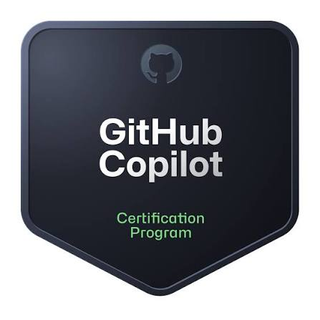
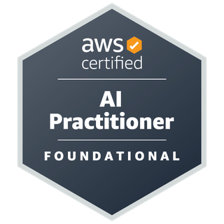
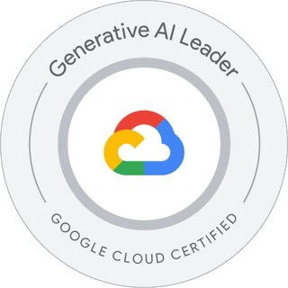
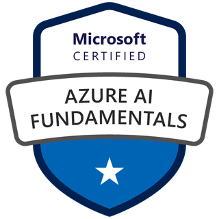

<pre>
╔══════════════════════════════════════════════════════════════╗
║  yash@github:~$ whoami                                      ║
║                                                              ║
║   ██╗   ██╗ █████╗ ███████╗██╗  ██╗                         ║
║   ╚██╗ ██╔╝██╔══██╗██╔════╝██║  ██║                         ║
║    ╚████╔╝ ███████║███████╗███████║                         ║
║     ╚██╔╝  ██╔══██║╚════██║██╔══██║                         ║
║      ██║   ██║  ██║███████║██║  ██║                         ║
║      ╚═╝   ╚═╝  ╚═╝╚══════╝╚═╝  ╚═╝                         ║
║                                                              ║
║   Lead Software Engineer | AI + Cloud Full-Stack            ║
║   Building systems. Automating workflows. Shipping impact.  ║
╚══════════════════════════════════════════════════════════════╝
</pre>

### Yash Srivastav

**Lead Software Engineer · AI & Cloud Full-Stack Engineer**

Building cloud-native platforms, intelligent developer tools, and production-ready applications.

 

---

## 👨‍💻 About Me

**Lead Software Engineer | AI/Cloud Full-Stack Engineer**

I build and modernize production software across **cloud-native platforms, AI-enabled engineering workflows, and full-stack applications**. My work spans backend architecture, AWS serverless systems, event-driven integrations, frontend delivery, and applied Generative AI.

- ☁️ **Cloud & architecture:** AWS Serverless, ECS, CDK, event-driven systems, API design, and platform modernization.
- 🧠 **AI engineering:** GenAI-assisted development, LLM-powered workflows, AI/ML prototypes, and agentic tools.
- 🧱 **Full-stack delivery:** React, Next.js, .NET, Python, Node.js, and TypeScript.
- 🚀 **Engineering impact:** Production delivery, performance improvements, reliability engineering, technical ownership, and cross-functional collaboration.
- 🏆 **Recognition:** MVP – Developer Award 2026 · Top Talent FY26 · Semicolons Hackathon Top 8 Finalist.

---

## 🚀 Featured Work

A selection of products, engineering experiments, and developer tools I've built.

<table>
<tr>
<td width="50%" valign="top">

### 🚦 [SprintPulse AI](https://github.com/Yash-srivastav16/Sprint-Pulse)

**AI-powered sprint risk intelligence**

Correlates standup updates, Jira movement, Git activity, and PR signals to identify delivery risks and the gap between reported progress and engineering evidence.

AI/ML · NLP · MCP · TypeScript · Supabase

</td>
<td width="50%" valign="top">

### 🏙️ [CityMail Finder](https://github.com/Yash-srivastav16/citymail-finder)

**Chrome extension for business contact research**

Manifest V3 extension with city-based workflows, CSV/XLSX input, local result storage, deduplication, resumable runs, and Excel export.

<a href="https://chromewebstore.google.com/detail/citymail-finder/bnmmknajlfeohmhfhcckjjglbemejnmk">Chrome Web Store ↗</a>

React · TypeScript · Chrome APIs · IndexedDB

</td>
</tr>
<tr>
<td width="50%" valign="top">

### 🤖 [Agentic SDLC Suite](https://github.com/Yash-srivastav16/agentic-sdlc-suite)

**Human-in-the-loop AI software delivery**

A control room that takes work from idea and architecture through task planning, role-based agents, code generation, review, QA, and release checkpoints.

Next.js · Agents · OpenAI · Gemini · SQLite

</td>
<td width="50%" valign="top">

### 🎓 [Agentic Learning Hub](https://github.com/Yash-srivastav16/agentic-learning-hub)

**Structured, AI-assisted learning experience**

A Docker learning platform with 30 lessons, progress tracking, quizzes, notes, glossary, milestones, and a reusable course-builder skill.

<a href="https://yash-srivastav16.github.io/agentic-learning-hub/">Live learning hub ↗</a>

HTML · CSS · JavaScript · GitHub Pages

</td>
</tr>
<tr>
<td width="50%" valign="top">

### 🔐 [GitHub Secrets Scanner Action](https://github.com/Yash-srivastav16/github-secrets-scanner-action)

**Secret detection in CI workflows**

A reusable GitHub Action that scans repositories for configurable secret patterns to help prevent accidental credential exposure.

GitHub Actions · CI/CD · Security

</td>
<td width="50%" valign="top">

### 🧪 More Projects

Explore my GitHub repositories for additional experiments, developer tools, and engineering projects.

<a href="https://github.com/Yash-srivastav16?tab=repositories">Browse all repositories ↗</a>

</td>
</tr>
</table>

---

## 🛠️ Engineering Toolkit

**Languages**

**Frontend & Backend**

**Cloud, Data & DevOps**

<strong>Explore my platform and cloud experience</strong>

| Area | Technologies |
|---|---|
| **AWS & Serverless** | Lambda, S3, SNS, SQS, CloudWatch, DynamoDB, API Gateway, CDK, IAM, EC2, ECS |
| **Architecture** | Serverless architecture, event-driven architecture, REST APIs, microservices |
| **Application frameworks** | React.js, Next.js, Node.js, Express.js, FastAPI, .NET Core |
| **Databases** | DynamoDB, PostgreSQL, MySQL, MSSQL, SQL Server |
| **DevOps & delivery** | CI/CD, GitHub Actions, GitLab, Docker, Git, Agile/Scrum, Jira |
| **Quality engineering** | Cypress, unit testing, test coverage improvement, code review |

---

## 🎓 Verified Certifications

  
  &nbsp;&nbsp;
  
  &nbsp;&nbsp;
  

  
  &nbsp;&nbsp;
  

| Certification | Issued | Valid until | Credential |
|---|---|---|---|
| **GitHub Copilot** · Microsoft | Jul 2026 | Jul 2028 | [View credential](https://learn.microsoft.com/api/credentials/share/en-us/YashSrivastav-6456/DF0912B4759CB9D2?sharingId) · `DF0912B4759CB9D2` |
| **Claude Certified Architect – Foundations** · Anthropic | Jul 2026 | Jul 2027 | [View Credly badge](https://www.credly.com/badges/1051f19e-b460-4dd5-97da-880f266ec5e8/linked_in_profile) |
| **AWS Certified AI Practitioner (AIF-C01)** · AWS | Mar 2026 | Mar 2029 | [AWS verification portal](https://aws.amazon.com/verification) · `d1bf97c426e34c39b8b137c71da5fe3a` |
| **Generative AI Leader** · Google Cloud | Mar 2026 | Mar 2029 | [View Credly badge](https://www.credly.com/badges/a59228a1-7cf2-4405-9cb6-d0b37e037c88/linked_in_profile) |
| **Microsoft Certified: Azure AI Fundamentals** · Microsoft | Feb 2026 | No expiry listed | [View Credly badge](https://www.credly.com/badges/b81b2c7a-f473-4fa7-8937-bdf768a7674b/linked_in_profile) · `wYkP9-2FMo` |

  Each badge links to its issuer's credential page or verification portal. AWS credential verification requires entering the credential ID on the AWS portal.

---

## 🏆 Awards & Recognition

| Recognition | Achievement |
|---|---|
| **MVP – Developer Award 2026** | Individual developer recognition |
| **Top Talent FY26** | Recognized as a top-performing engineer company-wide |
| **Semicolons Hackathon 2026** | Top 8 finalist out of 1,400+ teams; led SprintPulse AI |
| **Bravo Team Awards ×2** | Recognized for high-impact client delivery |
| **Bravo Individual Award** | Recognized for performance and proactive initiative |
| **Semicolons Hackathon 2025** | Best Solution – Healthcare & Life Sciences vertical |

---

## 🤝 Let's Build Something

I'm interested in conversations around **cloud architecture, AI engineering, developer tooling, platform modernization, and building products that solve real problems.**

